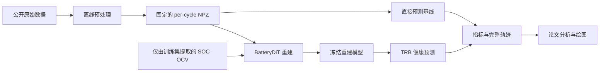

<div align="center">

# BatteryDiT

**面向鲁棒电池健康预测的物理先验扩散重建框架**

<p>
  <a href="environment.yml"></a>
  <a href="environment.yml"></a>
  <a href="environment.yml"></a>
  <a href="source_code/exp/protocol.py"></a>
  <a href="https://github.com/JohnResse1/BatteryDiT/releases/tag/v0.1.0-pre-results"></a>
</p>

[English](README.md) · [完整复现说明](source_code/README-zh.md) · [数据协议](source_code/data/README.md) · [论文绘图](analysis/README-zh.md)

</div>

BatteryDiT 从缺失或受扰动的充电测量中重建完整轨迹，再基于恢复后的信号估计
电池健康状态（SOH）。本仓库是数据构建、模型训练、鲁棒性评估和论文绘图的
完整复现工作区。

## 整体流程



数据预处理、模型实验和论文分析彼此分离。训练只读取已经定稿的数据和
train-only SOC–OCV prior；分析只读取正式实验保存的结果，不重新运行模型。

## 仓库包含什么

- MIT、HUST、MICH、SDU、Stanford_2 和保留的 TJU cohort 的统一离线预处理。
- 固定 cell 划分、统一标签和 clean/corrupted 严格配对的数据格式。
- BatteryDiT、物理算子、固定 SOC–OCV prior、重建基线、TRB 和直接预测基线。
- 重建 benchmark、下游 SOH 预测、压力测试、多数据集验证以及
  population/individual 分解的正式入口。
- 在绘图前主动检查 seed、模型和 condition 是否齐全的论文分析代码。

## 目录结构

```text
BatteryDiT_clean_rebuild/
├── source_code/
│   ├── main.py                 # 所有模型实验的统一入口
│   ├── data_preprocessing/     # 原始数据 -> 正式 per-cycle NPZ
│   ├── data/                   # 本地原始数据与生成数据
│   ├── data_provider/          # 唯一的正式数据读取层
│   ├── models/                 # BatteryDiT、PO/OCV、基线与预测器
│   ├── exp/                    # 正式实验 runner
│   ├── configs/                # 固定实验协议
│   └── checkpoints/            # 本地模型权重
├── run_scripts/                # 分类整理的复现命令
├── analysis/                   # 论文表格与图片
├── results/                    # 指标和导出的完整轨迹
├── tests/regression/           # 协议与 checkpoint 兼容性检查
└── docs/                       # 论文文档与重构记录
```

原始数据、生成的 NPZ、模型权重和完整轨迹都属于本地大文件，无需通过 Git 管理。

## 安装环境

```bash
conda env create -f environment.yml
conda activate batterydit-robust-soh
```

记录的正式环境使用 Python 3.10、PyTorch 2.0.1 和 CUDA 11.8，完整依赖见
[`environment.yml`](environment.yml)。

## 快速开始

将公开原始数据放入 `source_code/data/raw_sources/`，然后生成正式数据：

```bash
cd source_code
python -m data_preprocessing.main --dataset mit
```

回到仓库根目录，运行一个 BatteryDiT 重建及其对应的 TRB：

```bash
cd ..
bash run_scripts/benchmark/run_reconstruction.sh mit 2021 batterydit true
bash run_scripts/benchmark/run_downstream.sh mit 2021 batterydit trb
```

所有正式模型实验最终都进入 `source_code/main.py`。Shell 脚本只负责填入固定协议参数
和匹配的 checkpoint 路径。

## 正式实验

| 科学问题 | 主入口 | 主要输出 |
| --- | --- | --- |
| 受损充电轨迹能够被多准确地恢复？ | `Reconstruction` | 五视图波形指标与完整重建轨迹 |
| 重建是否改善 SOH 预测？ | `PredictDownstream`、`DirectPrediction` | 五视图 SOH/RUL 指标 |
| 不同扰动强度下是否仍然稳定？ | `ReconstructionStressTest`、`PredictStressTest`、`DegradationSignature` | 五档压力测试结果 |
| 方法能否适用于不同电池体系？ | `MultiDataset` | dataset × seed 的重建和预测结果 |
| population 与 individual 信号能否恢复？ | `PopulationIndividual` | 两类误差的分解结果 |

正式模型种子为 `2021`、`2022`、`2023`。模型选择统一使用严格配对的
`clean`、`downsample`、`segment`、`random` 和 `destructive` 五种 validation view。

## 输出位置

模型权重与实验结果分开保存：

```text
source_code/checkpoints/<task>/<dataset>/<setting>/
results/<task>/<dataset>/<setting>/
```

结果目录记录运行配置、validation history、test metrics 和可选的完整轨迹。
分析代码不会读取旧仓库，也不会在正式结果缺失时静默使用不完整的 seed 作图。

## 进一步阅读

- [`source_code/README-zh.md`](source_code/README-zh.md)：完整复现流程和实验依赖顺序。
- [`source_code/data/README.md`](source_code/data/README.md)：正式数据清单、来源和引用。
- [`source_code/data_preprocessing/README-zh.md`](source_code/data_preprocessing/README-zh.md)：
  预处理定义、固定划分和标签规则。
- [`run_scripts/README-zh.md`](run_scripts/README-zh.md)：本地命令与批量任务说明。
- [`analysis/README-zh.md`](analysis/README-zh.md)：论文图片入口和结果完整性要求。

使用数据时请引用正式数据清单中列出的公开来源。BatteryDiT 论文的正式引用信息将在
归档版本发布后补充到此处。
