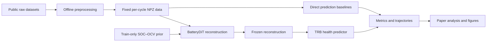

<div align="center">

# Unified battery trajectory recovery under heterogeneous observation degradation reveals distinct dimensions of fidelity

**BatteryDiT · Physics-informed diffusion reconstruction for robust battery health prediction**

<p>
  <a href="environment.yml"></a>
  <a href="environment.yml"></a>
  <a href="environment.yml"></a>
  <a href="LICENSE"></a>
  <a href="https://github.com/JohnResse1/BatteryDiT/releases/tag/v0.1.1-pre-results"></a>
</p>

[中文说明](README-zh.md) · [Reproduction guide](source_code/README-zh.md) · [Data protocol](source_code/data/README.md) · [Analysis](analysis/README-zh.md)

</div>

BatteryDiT reconstructs complete charging trajectories from incomplete or
corrupted measurements, then estimates battery state of health (SOH) from the
recovered signal. This repository is the clean implementation and reproduction
workspace used for data construction, model training, robustness evaluation,
and paper figures.

## Workflow



The preprocessing, training, and analysis layers are deliberately separated.
Training reads only finalized data and fixed train-only SOC–OCV priors; analysis
reads only recorded experiment outputs.

## What is included

- A unified offline preprocessing pipeline for MIT, HUST, MICH, SDU,
  Stanford_2, and retained TJU cohorts.
- One formal data schema with fixed cell splits and paired clean/corrupted
  validation and test views.
- BatteryDiT and its physics operator, fixed SOC–OCV priors, reconstruction
  baselines, TRB, and direct prediction baselines.
- Reproduction runners for the reconstruction benchmark, downstream SOH
  prediction, stress tests, cross-dataset evaluation, and population/individual
  recovery analysis.
- A separate analysis package that checks result completeness before producing
  publication figures.

## Repository layout

```text
BatteryDiT_clean_rebuild/
├── source_code/
│   ├── main.py                 # single experiment entry point
│   ├── data_preprocessing/     # raw sources -> formal per-cycle NPZ
│   ├── data/                   # local raw and generated data
│   ├── data_provider/          # canonical formal data loader
│   ├── models/                 # BatteryDiT, PO/OCV, baselines, predictors
│   ├── exp/                    # formal experiment runners
│   ├── configs/                # frozen experiment protocols
│   └── checkpoints/            # local model state files
├── run_scripts/                # reproducible command-line workflows
├── analysis/                   # paper tables and figures
├── results/                    # metrics and exported trajectories
├── tests/regression/           # protocol and compatibility checks
└── docs/                       # manuscript and refactoring records
```

Large raw data, generated NPZ files, checkpoints, and trajectory arrays are
local artifacts and are not required to live in Git.

## Environment

```bash
conda env create -f environment.yml
conda activate batterydit-robust-soh
```

The recorded environment uses Python 3.10, PyTorch 2.0.1, and CUDA 11.8. See
[`environment.yml`](environment.yml) for the complete scientific Python stack.

## Quick start

Place the public raw inputs under `source_code/data/raw_sources/`, then build a
formal dataset:

```bash
cd source_code
python -m data_preprocessing.main --dataset mit
```

Run one BatteryDiT reconstruction and its matching TRB predictor from the
repository root:

```bash
cd ..
bash run_scripts/benchmark/run_reconstruction.sh mit 2021 batterydit true
bash run_scripts/benchmark/run_downstream.sh mit 2021 batterydit trb
```

Every formal model experiment ultimately enters through `source_code/main.py`.
The shell scripts only supply the fixed protocol arguments and checkpoint paths.

## Experiment groups

| Scientific question | Entry point | Main output |
| --- | --- | --- |
| How accurately can corrupted charging trajectories be recovered? | `Reconstruction` | Five-view waveform metrics and reconstructed trajectories |
| Does reconstruction improve SOH prediction? | `PredictDownstream`, `DirectPrediction` | Five-view SOH/RUL metrics |
| How does performance change with corruption severity? | `ReconstructionStressTest`, `PredictStressTest`, `DegradationSignature` | Five-level stress readouts |
| Does the method transfer across battery systems? | `MultiDataset` | Dataset-by-seed reconstruction and prediction results |
| Which population and individual signals are recoverable? | `PopulationIndividual` | Population/individual error decomposition |

The formal model seeds are `2021`, `2022`, and `2023`. Model selection uses the
five paired validation views: `clean`, `downsample`, `segment`, `random`, and
`destructive`.

## Outputs

Model states and scientific outputs are kept separate:

```text
source_code/checkpoints/<task>/<dataset>/<setting>/
results/<task>/<dataset>/<setting>/
```

The result directory records configuration, validation history, test metrics,
and optional full trajectories.

## Documentation

- [`source_code/README-zh.md`](source_code/README-zh.md): complete Chinese
  reproduction guide and experiment order.
- [`source_code/data/README.md`](source_code/data/README.md): formal data
  inventory, provenance, and dataset citations.
- [`source_code/data_preprocessing/README-zh.md`](source_code/data_preprocessing/README-zh.md):
  preprocessing definitions and fixed labels.
- [`run_scripts/README-zh.md`](run_scripts/README-zh.md): local execution and
  batch-run commands.
- [`analysis/README-zh.md`](analysis/README-zh.md): figure entry points and
  required result contracts.

Dataset users should cite the original public sources listed in the formal data
inventory. A BatteryDiT paper citation will be added here with the archival
release.

## License

The source code is released under the [MIT License](LICENSE). Third-party
datasets remain subject to the terms of their original providers.
