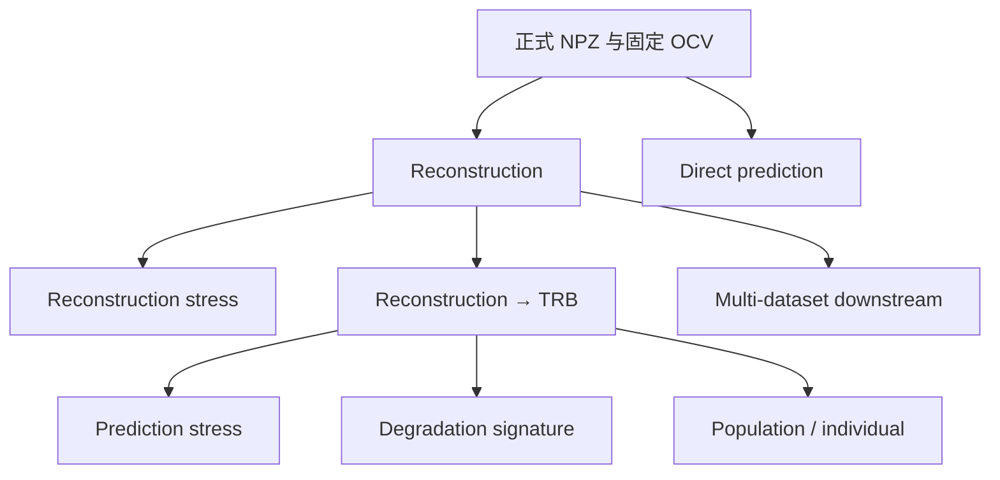

# 运行脚本

所有脚本从任意工作目录调用均可；它们会自行定位仓库根目录和
`source_code/`。先赋予执行权限：

```bash
chmod +x run_scripts/*/*.sh
```

| 目录 | 用途 |
| --- | --- |
| `preprocessing/` | 从 `data/raw_sources/` 重建正式 NPZ |
| `benchmark/` | 单数据集 reconstruction 与冻结 reconstruction 后的 TRB |
| `stress/` | 固定 checkpoint 的 reconstruction、SOH 与 degradation-order 压力测试 |
| `multi_dataset/` | 论文七 cohort × 三 seed 的批量 reconstruction/TRB |
| `population_individual/` | 六个 nominal-SOH 系统的 25 条件 frozen 分解计算 |

## 任务依赖



`DirectPrediction` 与重建 checkpoint 无关，可以独立运行。其余下游任务必须读取
相同 dataset 与 seed 的 validation-selected reconstruction；prediction stress、
degradation signature 和 population/individual 还需要匹配的 predictor checkpoint。

普通 benchmark 结果分别写入 `results/Reconstruction/` 和
`results/PredictDownstream/`；checkpoint 分别写入同名的
`source_code/checkpoints/` 目录。多数据集任务统一写入
`results/multi_dataset/`。

`benchmark/run_reconstruction.sh` 可按顺序接收数据集、seed、模型和是否导出
trajectory，例如 `./run_scripts/benchmark/run_reconstruction.sh mit 2021 csdi`。
模型为 `batterydit`、`transformer`、`csdi` 或 `kalman`；Kalman 只评估，不训练。
`benchmark/run_all_reconstruction_models.sh mit 2021` 会连续运行四个正式重建基线。
对应的 `benchmark/run_downstream.sh mit 2021 csdi` 会读取同名的 reconstruction
checkpoint，并训练该重建器对应的 TRB。应先完成 reconstruction benchmark。
其第四个参数可设为 `tcn`，用于论文中的 BatteryDiT→TCN 对照。
直接预测基线使用 `benchmark/run_direct_prediction.sh mit 2021 lstm`；
`run_all_direct_models.sh` 会依次运行 LSTM、GRU、Transformer、TCN 和 raw-TRB。

`benchmark/run_reconstruction.sh` 的 `SAVE_TRAJECTORIES` 默认为 `true`，因此会生成
五个 `reconstructions_<condition>.npz`，供 benchmark 与 cross-system 论文绘图使用。
只有明确不需要完整轨迹时，才将第四个参数传为 `false`。

所有脚本采用正式默认协议（200 epochs、batch size 64）。重建模型的优化器、
学习率和 scheduler 固定在 `source_code/exp/protocol.py`，避免由不同脚本造成
基线设置漂移；修改 epoch 或 batch size 后的运行不再是默认正式设置。

常用脚本参数如下：

| 脚本 | 位置参数 |
| --- | --- |
| `benchmark/run_reconstruction.sh` | dataset、seed、reconstruction model、是否保存轨迹 |
| `benchmark/run_downstream.sh` | dataset、seed、reconstruction model、predictor |
| `benchmark/run_direct_prediction.sh` | dataset、seed、direct model、是否训练 |
| `stress/run_reconstruction_stress.sh` | dataset、seed、reconstruction model |
| `stress/run_prediction_stress.sh` | dataset、seed、reconstruction model |
| `stress/run_degradation_signature.sh` | dataset、seed |
| `population_individual/run.sh` | dataset、seed |

`stress/run_degradation_signature.sh mit 2021` 从相同 seed 的 BatteryDiT/TRB
checkpoint 提取 clean、corrupted 与 reconstructed 的 TRB latent，并用固定的
clean-training Ridge probe 计算 Kendall tau-b。所有 stress readout 共用 observation
seed 3407；`seed` 参数只标识模型训练 seed。
